<p align="center">
  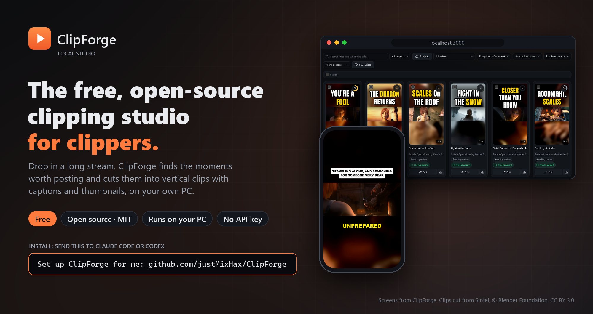
</p>

<p align="center">
  
  
  
  
  
</p>

# ClipForge AI

**The free, open-source clipping studio for clippers.** Give it a long stream or video. It finds the moments most
likely to work as short clips, tells you why it picked each one, and cuts them into vertical clips with captions
and a thumbnail, ready to post. Everything runs on your own Windows PC, in your browser at `http://localhost:3000`.

- **Free, for real.** MIT licence: no subscription, no account, no watermark on your clips.
- **Your own Claude picks the clips.** With [Claude Code](https://claude.com/claude-code) signed in, Claude finds
  the moments, writes the titles and post text, and makes edits you describe in plain words ("bigger yellow
  subtitles, cut the part where he reads chat"), all on the Claude plan you already have, with no API key and no
  extra bill. ChatGPT can give a second opinion the same way. Without either, ClipForge's own rules pick.
- **You say what you are looking for.** Funny moments, gameplay showcase, hype, horror, rage, streamer moments,
  wholesome, educational, or stories and hot takes: Claude is held to that kind, opens every clip on its
  strongest second, then takes a second look at each pick and drops what does not hold up. Let it look at the
  picture too and it judges frames of each pick as well, which is how a scare or a clean run with no talk gets
  found.
- **Ready to post.** 9:16, 1:1, 4:5 or 16:9; captions word by word in six styles or your own; a hook title; a
  thumbnail with big words; a TikTok caption and hashtags.
- **Built for clippers.** Facecam and gameplay layouts, game vocabularies (GTA, DayZ, EA Sports FC, Roblox), clips
  from your own timestamps, a score for every clip with the reasons behind it, and Creator Discovery to follow
  the YouTube channels you clip from.
- **Your videos stay on your PC.** When Claude picks, it gets the transcript, not the video; a few small still
  frames of its picks go with it only if you switch that on. No telemetry, no update check. [SECURITY.md](SECURITY.md) lists everything that goes over the network, and when.

> [!NOTE]
> **This is the first release, and ClipForge is not finished yet.** It works and it is used on real streams, but it
> is early: it has been tested on one PC, and some parts are still being built. New improvements are coming.
> [ROADMAP.md](ROADMAP.md) shows what is next. Watch or star the repository to hear about each new release.

**Status.** Built and tested by one person on one PC, with more than 1,100 automated tests. Clipping, editing
and thumbnails are used on real streams. Publishing and Creator Discovery are built and tested against local
stand-ins of the platforms' APIs; they need your own accounts and key before their first real request, and the
app says so wherever that matters. The list under [What works](#what-works-and-what-does-not) is kept honest.

## Install: ask your AI

ClipForge is installed by your own AI. Open **Claude Code**, or **Codex** in the ChatGPT desktop app, and send it:

```text
Set up ClipForge for me: https://github.com/justMixHax/ClipForge
```

It checks your PC, asks before it installs anything or downloads the speech model, sets ClipForge up, starts it,
and puts a **ClipForge** shortcut on your desktop. Then it tells you where to begin.

You need 64-bit Windows 10 or 11 and about 3 GB of free disk space. A chat window in the browser cannot do this,
because it cannot run anything on your PC: it has to be Claude Code or Codex.

Your AI follows [AGENTS.md](AGENTS.md), which lists every step it takes and every download, so you can read
exactly what it will do first. [SETUP_WINDOWS.md](SETUP_WINDOWS.md) is the full manual behind it, with options
and troubleshooting.

After that: double-click **ClipForge** on your desktop to start it (if it is already running, the shortcut just
opens it). To stop it, press **Shut down ClipForge** at the bottom of the app's menu; a job that is running
continues next time.

## Take the tour

Every picture is a real screenshot of ClipForge. The clips are cut from *Sintel*, an open movie (credit below).

### Dashboard
Your best clips, what this PC is doing, and a work log saying what ClipForge and Claude each did.

<p align="center">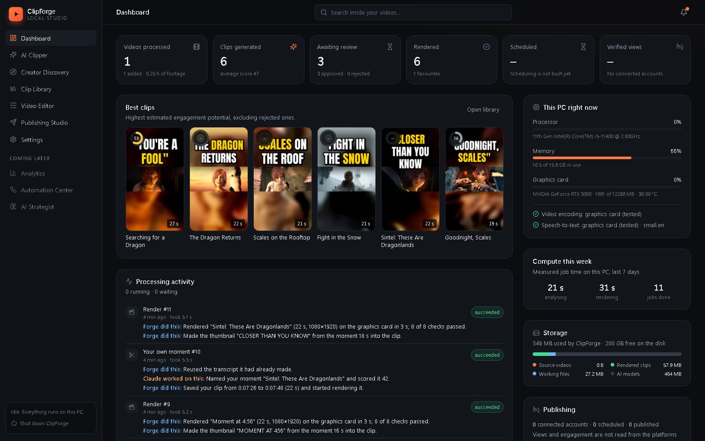</p>

### AI Clipper
Add a video (upload, a link to a public video, or a file on your PC), pick how to clip it, and get ranked clips.
Each one says who picked it, how sure the score is, and why.

<p align="center">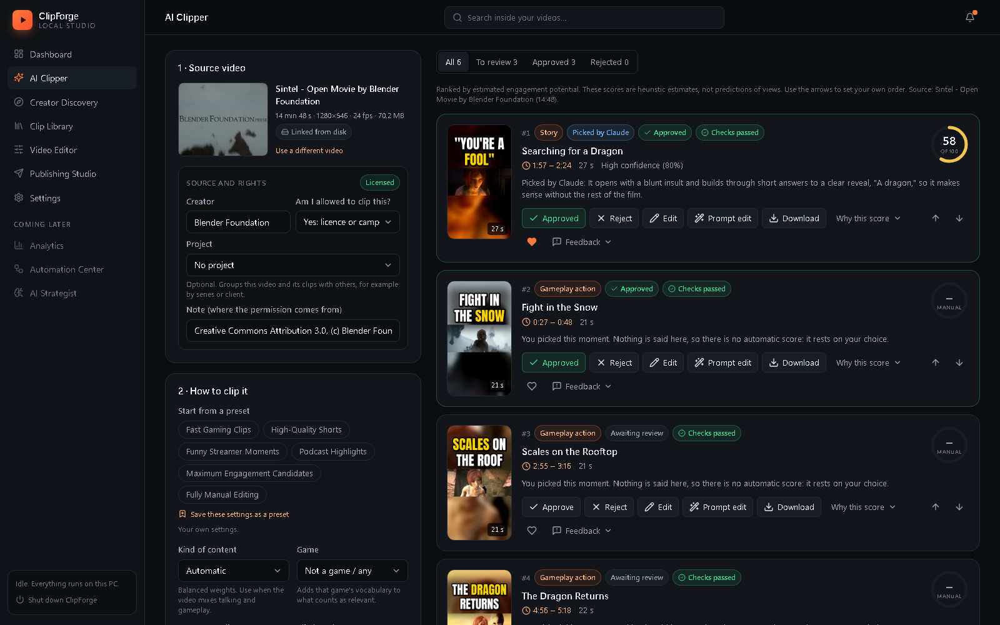</p>

### Why this score
Twelve sub-scores and the evidence behind each one, with the exact lines and times from the video.

<p align="center">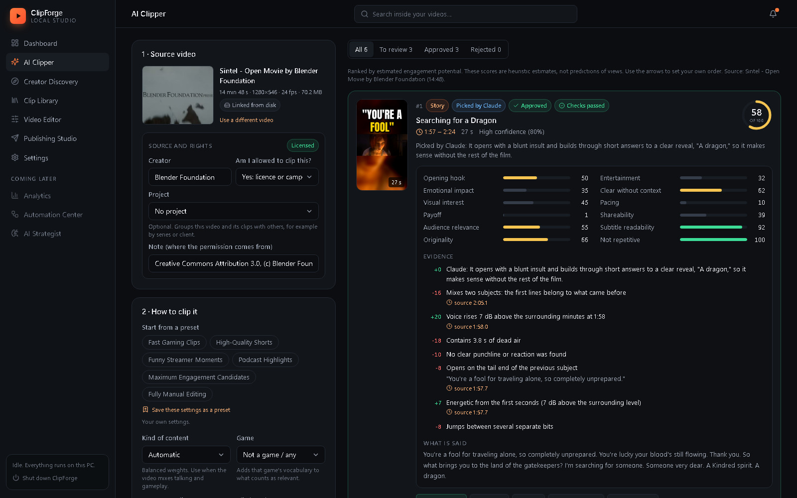</p>

### Prompt edit
Describe a change in your own words. Claude makes it and the clip is rendered again; one press undoes it.

<p align="center">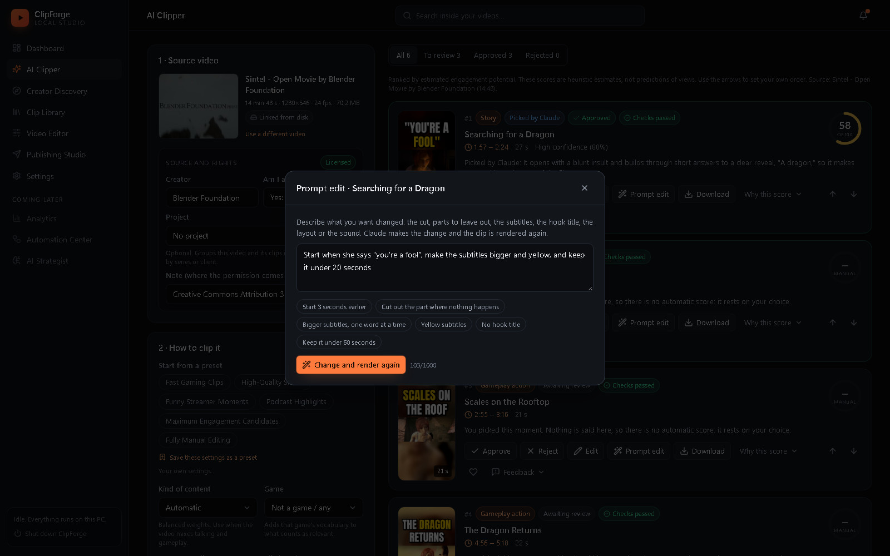</p>

### Clip Library
Every clip with its thumbnail, score and checks: it plays, has sound, and keeps its captions inside the frame.
Filter, sort, approve, favourite, export.

<p align="center">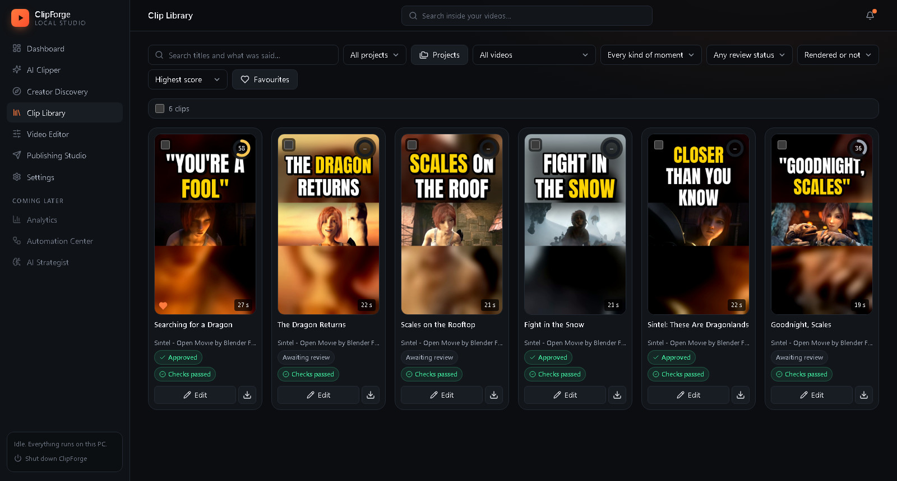</p>

### Video editor
Trim on the waveform, fix any caption word, and change the caption style, layout, thumbnail and post text,
with undo and redo.

<table><tr>
<td width="50%">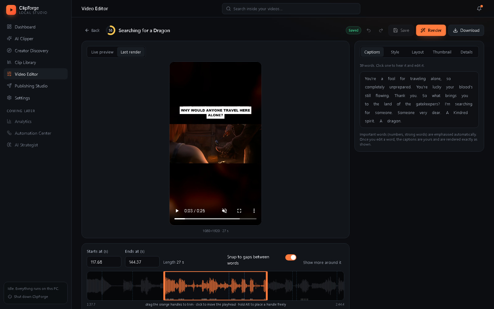</td>
<td width="50%">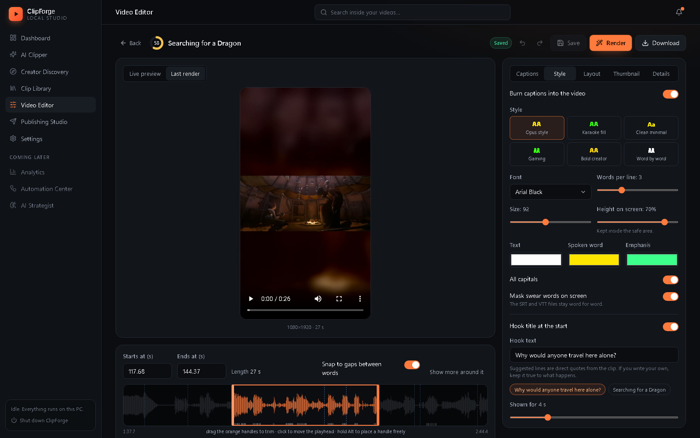</td>
</tr></table>
<table><tr>
<td width="50%">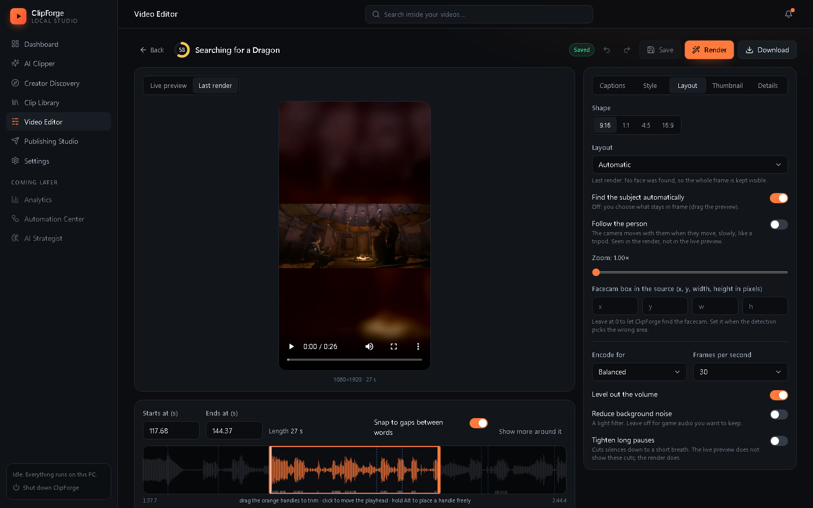</td>
<td width="50%">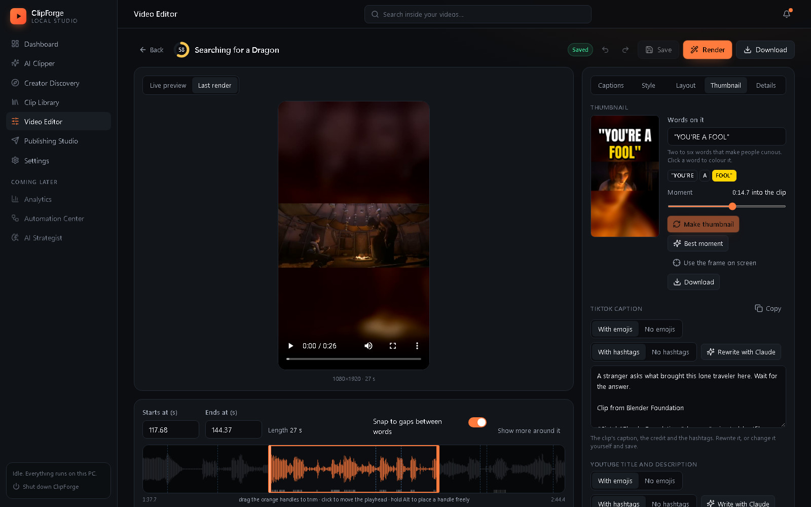</td>
</tr></table>

### Creator Discovery
Follow the YouTube channels you clip from and see their new videos with what viewers say about them. It uses
YouTube's official API with a free key of your own; this is the screen before the key is added.

<p align="center">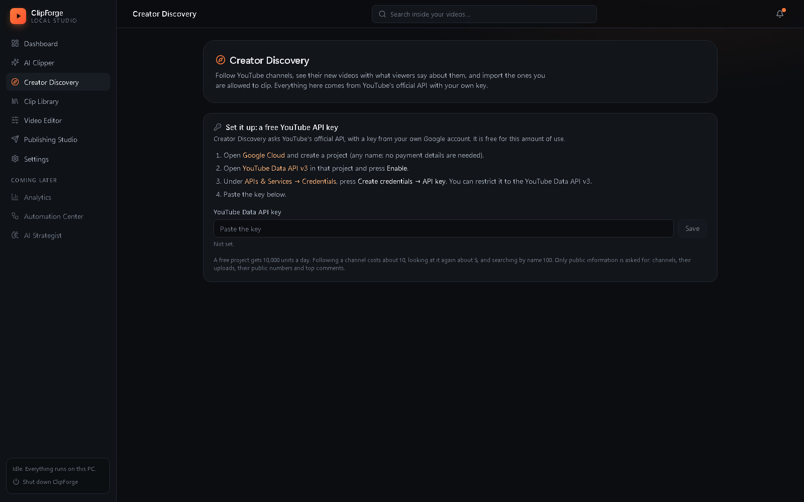</p>

### Publishing Studio
Post approved clips to YouTube Shorts, TikTok (as drafts) and Instagram Reels, now or on a schedule, through each
platform's official API and your own sign-in. Each platform walks you through its one-time setup.

<table><tr>
<td width="50%">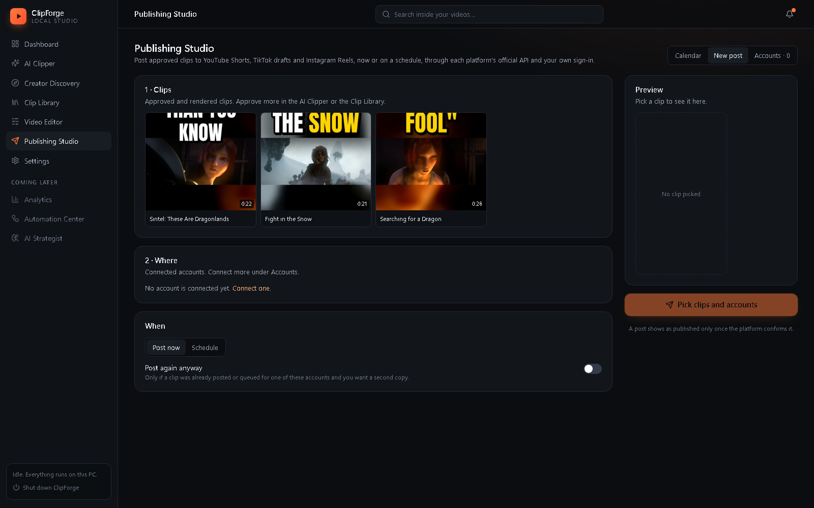</td>
<td width="50%">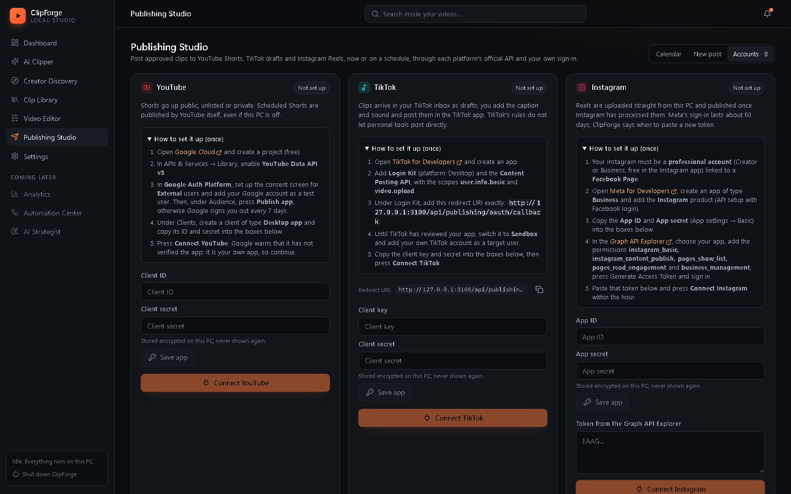</td>
</tr></table>

### Settings
What this PC can do, tested rather than guessed: graphics card, speech models, storage, and the honest status of
every part of ClipForge.

<p align="center">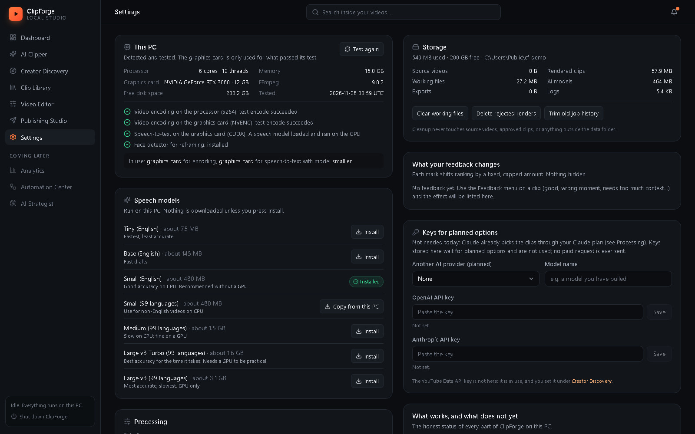</p>

<sub>The clips in these pictures are cut from [Sintel](https://durian.blender.org), © copyright Blender
Foundation, licensed under [Creative Commons Attribution 3.0](https://creativecommons.org/licenses/by/3.0/). Two
were picked and named by Claude; four are moments chosen by hand, three of them renamed in the editor because
nothing is said in them.</sub>

## Using it

1. **AI Clipper → 1 · Source video.** Three ways to bring a video in:
   - drop a file (MP4, MOV, MKV, WebM, M4V) or choose one;
   - **paste a link** to a public video (YouTube, Twitch and Kick recordings, and most video sites), press
     **Check link**, say why you may clip it, and press **Import video** (a download smaller than 700 pixels
     on its short side gets a warning first: it will look soft once enlarged);
   - paste the path of a recording that is already on this PC (it is linked, not copied).

   Record who made it and whether you are allowed to clip it, and put it in a project if you want to group
   your work.
2. **2 · How to clip it.** Choose **what you are looking for** first: Best moments, Funny moments, Gameplay
   showcase, Hype / clutch, Horror / scares, Rage moments, Streamer moments, Wholesome / cosy, Educational, or
   Stories & hot takes (the same choice is offered with a link you paste). With a kind chosen, Claude gives only
   moments of that kind, fewer or none when the video does not have them, and never pads with other kinds.
   **Let Claude look at the picture too** sends eight small frames of each pick with its second look; for
   gameplay, hype and scares that is what lets a moment with little talk be found. Then pick a preset (Fast
   Gaming Clips, Funny Streamer Moments, Podcast Highlights, ...)
   or set the kind of content, game, number of clips, clip length, minimum score, shape, layout and caption
   style yourself. **Save these settings as a preset** keeps them under a name of your own, next to the built-in
   ones (the × on it removes it). Press **Generate Clips**.
3. **Watch the stages.** Extracting audio → transcribing → measuring sound and picture → finding the best
   moments → rendering. You can cancel; if the app is closed mid-job it continues next time.
4. **Review.** Each suggestion shows a 0–100 score, a confidence level, the reasons, the evidence
   (what was said, how the voice changed, where the payoff lands) and a breakdown of twelve sub-scores.
   Approve, reject, favourite, reorder, or tell it what was wrong (the feedback shifts future ranking).
5. **Edit.** Trim on a waveform timeline, fix any caption word, change the caption style, font, colours,
   layout, shape and hook title, with undo and redo. To cut a part out of the middle, move the playhead to
   where it starts and press **Leave out a part from here…**, then to where it ends and press **…to here**: it
   shows as a striped band on the waveform, the preview skips it, and the render leaves it out. Save and render
   again. To take the subtitles off a clip
   (or put them back), use the **Subtitles** switch in the clip's window and press **Confirm and render again**;
   the hook title keeps its own setting.

   **Prompt edit.** Or just say what you want: press **Prompt edit** on a clip (or use the box in the clip's
   window), describe the change in your own words, for example *start when he says "okay ladies", cut out the
   part where he reads chat, bigger yellow subtitles one word at a time, change the hook to "Cop or criminal?"*,
   and press **Change and render again**. Claude turns it into changes ClipForge can make: the cut, parts left
   out of the middle, the subtitles (style, font, size, height, colours, capitals, words per line, masking, the
   spelling of a word), the hook title, layout, shape, zoom, sound, title and thumbnail. Every value is checked
   within the editor's own limits, a cut never falls inside a word, and the list of what changed is shown. What
   ClipForge cannot do (music, sound effects, speed changes, stickers) is listed, never faked. **Undo this
   prompt edit** puts the clip back as it was and renders it again. One Claude request per edit, on your own
   plan. Parts left out are listed under the editor's timeline, where you can put each one back.
   Claude also sees the video: a typical frame and a strip of frames across the clip. So *"her camera on top,
   his camera under it"* in a recorded video call becomes a split screen of those two cameras, each fitted to
   the camera's own edges, and Claude says when a camera is missing at times (one layout serves the whole clip).
   To choose the two parts yourself, use **Choose the two parts…** in the editor's Layout tab (split screen or
   facecam over gameplay): draw a box round what goes on top and one round what goes below on a large frame.
6. **Download or export.** Download the MP4, SRT or VTT, or select clips in the Clip Library and export them
   to a folder with their thumbnails and a text file holding the title, TikTok caption, hashtags, source and
   rights note.
7. **Clip a moment yourself.** Found a good moment while watching? Under **3 · Clip a moment yourself**, type
   where it starts (`1:02:15`, `62:15`, or paste a YouTube link copied at that moment), or press **Watch and
   mark** and use **Start here** and **End here** in the player. Leave the end empty and Claude ends it right
   after the payoff. The same work as for the AI's picks follows: title, hook, score, ChatGPT's verdict,
   captions, render and checks. Your start is kept; only a start in the middle of a word moves to its edge.
8. **Thumbnail and TikTok caption.** Every rendered clip gets a thumbnail: its best moment (sharp, well lit, a
   face clearly visible), framed like the clip, with two to six big words on it and one of them in colour. The
   words stay clear of faces and of the bottom, where TikTok puts its caption and buttons. When Claude picks a
   clip it also writes those words, a TikTok caption and hashtags, from what is really said; otherwise the words
   come from the title. In the clip's window or the editor's **Thumbnail** tab you can change the words, the
   word in colour and the moment, download the picture and copy the caption. **Rewrite with Claude** writes a
   new TikTok caption from what is said (with or without emojis, with or without hashtags; the credit stays), and
   you can change it yourself and save it with the clip. **YouTube title and description** has Claude write a
   Shorts title and a description (what happens, one more line, a question for the comments), with the credit on
   its own line, then #Shorts and the hashtags; each box has Copy, and nothing is saved. Words in Arabic, Hebrew and
   similar scripts are not drawn yet (they need text shaping this setup lacks): those thumbnails get no words.
9. **Publish.** In the **Publishing Studio**, set up each platform once under **Accounts** (your own free
   developer app, then the platform's own sign-in; the page walks you through it). Then **New post**: pick
   approved clips, accounts, the text (Claude can suggest it) and now or a time. The **Calendar** shows what
   goes out when. A post reads Published only once the platform has confirmed it. Two posts on one account are
   kept at least 3 hours apart, so the platform can see how one does before the next (change or switch off that
   gap under **Accounts**).
10. **Follow the channels you clip from.** **Creator Discovery** uses YouTube's official API with a free key
    of your own (the page shows the four steps). Paste a channel's link or @handle and press **Follow**. For
    each of its new videos ClipForge shows what YouTube's public data says: how its views compare with the
    channel's usual, how many of its top comments are laughing, and the moments viewers wrote down in the
    comments ("12:34 😂"). Sort by any of those, then press **Import and find clips** on the ones worth it.
    Record once whether you may clip that creator; without that record, the import asks every time. Claude is
    told the moments viewers pointed at, as hints, and a clip that holds one says so in its evidence. Followed
    channels are looked at again every six hours while ClipForge runs (you choose how often, or never), and
    the page shows how much of YouTube's free daily quota that used. Once a video is in your library, the
    page shows how its clips scored, and **Its funny clips** opens them in the Clip Library, which can filter
    by the kind of moment.

## What works, and what does not

Checked on the author's PC (Windows 11, an RTX 3060) on 24 November 2026. The same list, live and for your
own PC, is in the app under **Settings → What works, and what does not yet**.

| | |
|---|---|
| **Working and tested** | Upload and link-from-disk · import from a link (public videos) · projects · **clips from your own timestamps** · **Claude picks the clips** (through the Claude Code tool and your own Claude plan, no API key; local rules as fallback) · **ChatGPT checks the picks** and may add missed ones (through the Codex tool and your own ChatGPT plan) · **a kind of moment to look for** (ten kinds, from funny to horror to educational), with **Claude's second look** at every pick, with frames of the video when you switch that on · a **work log** after every job saying what Forge, Claude and ChatGPT each did · local speech-to-text with word timings · highlight discovery with 12-part explainable scoring, plus loud and busy moments from stretches where almost nothing is said · content presets and game vocabularies (GTA, DayZ, EA Sports FC, Roblox) · review, ranking, feedback · clip editor, with parts left out of the middle · **your own presets** · **prompt edit** (describe a change; Claude makes it, the clip is rendered again, one press undoes it) · **a thumbnail for every clip** (best moment, big words, a TikTok caption and hashtags) · renders in 9:16, 1:1, 4:5 and 16:9 with four layouts · six caption styles plus your own, SRT and VTT · volume levelling, noise reduction, pause tightening · export quality checks · search inside transcripts · duplicate detection · A/B variants · export with post text · job queue with cancel, retry and resume · hardware detection · GPU video encoding (NVENC) · speech-to-text on the graphics card (about 4× faster than the processor here) |
| **Working, with a caveat** | Face-aware reframing and facecam detection: checked on real streams on 23 November 2026 (GTA RP, Rainbow Six, a desk stream). The camera panel was right every time; the gameplay panel showed the stream's own facecam a second time, which is fixed. The crop stays fixed for the whole clip unless you switch on **Follow the person** (editor → Layout, cropped layout, or ask in a prompt edit): then the camera pans sideways with them, like a heavy tripod. That is new on 24 November 2026: the moving crop is tested with real renders, but it has not yet been watched on a clip where someone really walks. |
| **Needs setup** | Speech-to-text on the graphics card: on a PC with an NVIDIA card, run `scripts\enable-gpu.ps1` once (about 1.3 GB); until then it runs on the processor. Claude and ChatGPT: the Claude Code tool and the ChatGPT app's Codex tool, each signed in; without them the local rules pick the clips. |
| **Waiting for your accounts** | **Publishing**: YouTube Shorts (upload and schedule), TikTok (to your drafts), Instagram Reels, with a queue, calendar, safeguards and Claude's post text. Built and tested against stand-ins of each platform's API made from its documentation; each needs your own developer app and sign-in before the first real post (Publishing Studio → Accounts). **Creator Discovery**: follow YouTube channels, see their new videos with what the public numbers and top comments say, import the ones you may clip. Built and tested against a stand-in of the YouTube Data API made from its documentation and from the real API's own refusals; it needs your own free API key before its first real request. |
| **Blocked by a third party** | TikTok direct posting: TikTok's rules for it exclude tools for posting to your own accounts. Drafts work instead. |
| **Planned, not built** | Analytics · AI strategist · automation rules (Creator Discovery finds the videos; you still choose which to import) · who-is-speaking detection · zoom pushes on big moments · a check for subtitles already burned into the source · hints from what Twitch viewers clipped |

The full plan is in [ROADMAP.md](ROADMAP.md).

## What the score means

The score is an estimate of engagement potential made by rules you can read, not a prediction of views.
Twelve things are scored from 0 to 100 and combined with weights that depend on the content preset: opening
hook, entertainment, emotional impact, clarity without context, visual interest, pacing, payoff,
shareability, audience relevance, subtitle readability, originality and repetition.

The signals are the transcript (what is said, how sentences begin and end), loudness compared with the
surrounding minutes, pauses, speaking speed, picture activity and scene cuts. A loud moment on its own does
not rank highly: loudness can lift only two of the twelve parts, and only so far. Suggestions start and end
on sentence boundaries, and titles and hook lines only use words that were actually said.

Where almost nothing is said (gameplay between bits of commentary, action scenes), the loud and busy moments
are offered as well. They only fill places the spoken moments left free, never cut a sentence in half, and
are marked "Low confidence" with the note that they rest on sound and picture only.

When Claude picks the clips, the score is Claude's own honest 0–100 for the moment, the twelve parts are still
measured by the rules, and the reason is Claude's. The confidence shown is fixed by where the pick came from,
not measured: 80% for Claude's picks, 70% for the ones ChatGPT adds, at most 74% for the local rules (they were
tuned on a synthetic test video and unit tests, not on a large set of real streams) and at most 45% for moments
found from sound and picture alone. Expect to disagree sometimes; that is what the feedback buttons and manual
ranking are for.

When you ask for a kind of moment, Claude also says how clearly each pick is that kind and quotes the line, or
names the event, that makes it one. Its second look then goes through every pick again as a sceptical editor:
what does not hold up is dropped, with the reason in the work log, and a kept clip's score is the mean of its
first score and the second look's. A clip the second look kept says so, with its reason. For a kind the picture
carries (gameplay, hype, scares), with the picture switched on, the loud and busy moments the local rules found
are put to that second look as well, and Claude names the ones it keeps from what it sees. The local rules on
their own can only approximate a kind: they lift moments from their own matching categories by 8 points, lower
the others by 12, and say so on each clip.

## Where things are

```
backend/     Python API, worker, analysis and rendering (FastAPI, SQLAlchemy, faster-whisper, FFmpeg)
frontend/    Browser interface (React, TypeScript, Vite, Tailwind)
scripts/     setup, start, stop, test, optional fonts, optional GPU libraries, sample video builder
data/        Everything the app creates: your videos, clips, the database, models, logs (not in Git)
samples/     Synthetic sample video and the script it was built from, used by the slow tests
docs/        Research notes on the reference projects
reviews/     The code reviews made before each commit, with what was done about every finding
```

Moving the project folder moves everything, because the database stores paths relative to `data/`. The one
exception is the Python environment: it lives in `backend\.venv`, or in `%USERPROFILE%\.clipforge\venv` when
the project path is long (Windows cannot load libraries from very long paths); `.venv-path` records where it is.

## Documentation

- [SETUP_WINDOWS.md](SETUP_WINDOWS.md): installing, starting, stopping, options, troubleshooting
- [ARCHITECTURE.md](ARCHITECTURE.md): how the parts fit together and why
- [TESTING.md](TESTING.md): what is tested, how to run it, and what is not covered
- [SECURITY.md](SECURITY.md): what protects your PC, your files and your future credentials
- [ROADMAP.md](ROADMAP.md): milestones, what is next, known limitations
- [CONTRIBUTING.md](CONTRIBUTING.md): running it for development, the tests, and the rules a change has to keep
- [THIRD_PARTY_NOTICES.md](THIRD_PARTY_NOTICES.md): everything setup installs, from where, under which licence
- [docs/RESEARCH.md](docs/RESEARCH.md): what was learned from clipping.net, GTA 6 Clipper, Clipify and OpenShorts

## Clipping other people's videos

A video being public does not make it yours to repost. ClipForge records a rights status for every source
(your own, licensed or campaign, creator gave permission, not allowed, not recorded) and writes it into the
post text of every clip. Credit does not replace permission.

Importing from a link works for public videos only. ClipForge never signs in to a site, never reads your
browser's cookies, and does not work around age, member or region restrictions. An import does not start
until you have said why you may clip that video, and your answer is stored with it.

## Licence

ClipForge AI is released under the [MIT licence](LICENSE): you may use, change and share it, also commercially,
as long as the copyright notice stays with it. It comes without any warranty. The licence covers ClipForge's own
code. The software that setup installs keeps its own licences
([THIRD_PARTY_NOTICES.md](THIRD_PARTY_NOTICES.md)), and no licence here gives a right to anyone's videos.

## Third-party software

ClipForge is built on other people's work, used under their licences:
faster-whisper and CTranslate2 (MIT) with OpenAI's Whisper models (MIT) · OpenCV (Apache 2.0) and the YuNet
face detector (MIT) · FFmpeg (the gyan.dev full build is GPL v3; it is run as a separate program, not linked) ·
FastAPI, SQLAlchemy, Alembic, Pydantic (MIT), Starlette and Uvicorn (BSD) · NumPy and psutil (BSD), Pillow
(MIT-CMU), cryptography (Apache 2.0 / BSD) · React, React Router, Vite, Tailwind CSS, TanStack Query (MIT),
Lucide icons (ISC) · yt-dlp for importing from links (Unlicense) · optional fonts Noto Sans, Montserrat, Anton
and Bebas Neue (SIL Open Font License). None of it is copied into this repository: setup installs it from its
own source. The full list, with every package setup brings along, is in
[THIRD_PARTY_NOTICES.md](THIRD_PARTY_NOTICES.md).

Ideas were adapted from three MIT-licensed projects, [Clipify](https://github.com/louisedesadeleer/clipify),
[GTA 6 Clipper](https://gitlab.com/nocodehack.io/gta6-clipper) and
[OpenShorts](https://github.com/mutonby/openshorts). The ideas were written again for ClipForge; none of their
code is in ClipForge or run by it.
